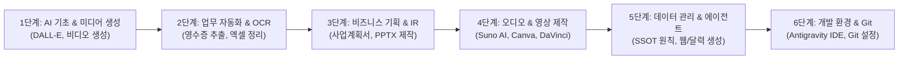

# 📊 [AI 활용 연수 3주차] 전체 교육과정 종합 결과보고서

---

## 📌 1. 연수 개요

* **과정명:** 생성형 AI 및 AI 도구 활용 실무 역량 강화 연수 (3주차)
* **목적:** 생성형 AI(텍스트, 이미지, 오디오, 비디오) 도구의 실무 활용법을 습득하고, 데이터 자동화, 비즈니스 기획 문서 작성, 영상 편집 및 AI 개발 환경(IDE/Git) 구축까지 전주기 실무 파이프라인을 완성함.
* **주요 강사진:** 유정근 교수, 주영욱 강사, 정수진 강사, 김윤정 강사
* **결과물 보관:** [AI활용연수3주차 워크스페이스](file:///C:/Users/user/Desktop/AI활용연수3주차)

---

## 🗺️ 2. 교육과정 로드맵 (커리큘럼 흐름)



---

## 📅 3. 일자별 세부 교육 내용 및 실습 성과

| 일자 / 강사 | 핵심 주제 | 주요 실습 내용 및 도구 | 주요 산출물 파일 |
| :--- | :--- | :--- | :--- |
| **~ 11/16** | **AI 미디어 생성 기초** | • 생성형 AI 프롬프트 작성 기초<br/>• 이미지 생성 (DALL-E / 타임리)<br/>• 숏폼 영상 클립 생성 | • `단풍풍경1.png`<br/>• `타임리_눈오는날.png`<br/>• `덕수궁 돌담길 4초.mp4` |
| **11/17**<br/>유정근 강사 | **문서 OCR 및 데이터 자동화** | • AI 기반 광학문자인식(OCR) 기술 실습<br/>• 다중 영수증 일괄 텍스트 추출 및 표 변환<br/>• AI 플랫폼별 개발 도구 및 환경 비교 분석 | • `4개영수증을한방에정리.xlsx`<br/>• `유정근교수님강의정리.pdf`<br/>• `AI 플랫폼별 개발 도구 비교표.pdf` |
| **11/18**<br/>주영욱 강사 | **비즈니스 기획 & IR 프레젠테이션** | • 미래 모빌리티/플라잉 캠핑카 스타트업 기획<br/>• AI를 활용한 사업계획서 초안 및 본문 작성<br/>• 프레젠테이션(PPTX) 자동 구조화 및 디자인 | • `미래 모빌리티 자동차.md`<br/>• `플라잉 캠핑카 주주 사업 현황 보고서.pdf`<br/>• `Flying_Camping_Car_Startup_IR.pptx` |
| **11/20**<br/>정수진 강사 | **AI 오디오 & 사운드 생성** | • AI 음악 생성 도구(Suno AI 등) 실습<br/>• 장르별/테마별 프롬프트 기반 음원 작곡<br/>• 영상용 배경음악(BGM) 및 효과음 추출 | • `미션임파서블_OST_.mp3`<br/>• 프로젝트별 테마 음원 |
| **11/23**<br/>정수진 강사 | **캔바(Canva) 디자인 & 콘텐츠 제작** | • 캔바 AI 디자인 템플릿 응용<br/>• 텍스트-애니메이션 비디오 합성<br/>• 명예의 전당 등 기념 영상 기획 및 렌더링 | • `한길동_명예의전당.mp4`<br/>• `photo_캔바제작/` 내 디자인 에셋 |
| **11/24**<br/>정수진 & 김윤정 강사 | **다빈치 리졸브 영상 편집 종합** | • 다빈치 리졸브(DaVinci Resolve) 실무 편집<br/>• AI 생성 음원(행진곡, 발라드 등)과 영상 싱크<br/>• '갈매기 5형제' 종합 영상 프로젝트 완성 | • `갈매기5형제.drp` (프로젝트 파일)<br/>• `갈매기5형제1.mp4`, `갈매기5형제2.mp4`<br/>• `갈매기-5형제-행진곡.mp3` 외 음원들 |
| **11/25**<br/>유정근 강사 | **문서 관리 체계(SSOT) & 자동화** | • 기업 공문서/회의록 SSOT(단일 진실 공급원) 실습<br/>• 민감정보 분리 및 파일 백업·버전 관리 체계화<br/>• 2027 농업경영 달력 및 파종계획 자동 생성 | • `2027_농업경영_달력.html`<br/>• `농경달력.pdf`<br/>• `농업경영_지역별파종계획표.docx` |
| **11/26**<br/>유정근 강사 | **개발 환경(IDE), 프롬프트 원칙 & Git** | • Antigravity IDE 환경 구축 및 규칙 수립<br/>• 프롬프트 엔지니어링 4대 원칙(역할/맥락/제약/형식)<br/>• Git 설치, 환경 변수 확인 및 사용자 등록 | • `GEMINI.md` / `law.md`<br/>• Git 사용자 설정 (`user.name`, `user.email`)<br/>• 대용량 파일 관리용 `.gitignore` 설정 |

---

## 💡 4. 핵심 학습 영역별 상세 정리

### 1) 멀티미디어 AI 콘텐츠 제작 (이미지·음악·영상)
* **이미지 생성:** 계절감 및 특정 분위기(가을 단풍, 설경, 호숫가 등)를 살리는 디테일 프롬프트 작성법 습득.
* **음악 생성:** 행진곡, 터키 메흐테르풍, 발라드, 응원가 등 분위기와 템포(BPM)를 지정하여 맞춤형 사운드트랙 제작.
* **영상 편집 실무:** 전문 편집 도구인 **다빈치 리졸브(DaVinci Resolve)**에 AI 영상과 음원을 불러와 컷 편집, 자막 삽입, 마스터링을 거쳐 최종 포트폴리오(`갈매기5형제`) 완성.

### 2) 비즈니스 문서 & 데이터 자동화
* **기획서 작성:** 시장 분석, 타겟 고객군(B2B/B2C), 단계별 로드맵을 체계적으로 구조화하여 IR 보고서 완성.
* **스마트 OCR:** 영수증, 견적서, 출석부 등의 비정형 이미지 데이터를 엑셀 및 표 데이터로 일괄 변환하여 단순 반복 업무 시간 대폭 단축.
* **웹 기반 시각화:** 농경 일정 데이터를 바탕으로 계절별 이미지와 결합된 반응형 웹 달력(`HTML`) 및 PDF 문서 자동 생성.

### 3) AI 작업 표준화 및 프롬프트 엔지니어링 (`GEMINI.md`)
AI에게 일관되고 신뢰성 높은 결과물을 얻기 위해 정의된 **4대 필수 원칙**:
1. **역할 (Role):** 업무에 적합한 전문가 페르소나 명시
2. **맥락 (Context):** 작업 배경, 대상, 목적 명확화
3. **제약 (Constraints):** 제외 사항, 보안 준수, 기술적 한계 설정
4. **형식 (Format):** 표, 마크다운, JSON 등 원하는 출력 형태 명시
* **SSOT(단일 진실 공급원) 원칙:** 원본 문서 훼손 방지 및 사실 기반 검증(Fact-checking) 철저 준수.

### 4) 버전 관리 시스템(Git) 기초 구축
* **설치 및 경로:** `C:\Program Files\Git\cmd\git.exe`
* **사용자 설정 완료:**
  * 사용자명: `git config --global user.name "하니벌"`
  * 이메일: `git config --global user.email "kdhan52@google.com"`
* **저장소 안전 규칙:** 100MB 초과 파일(`.exe`, 고용량 비디오 등)은 `.gitignore`에 등록하여 업로드 장애 방지.

---

## 🗂️ 5. 워크스페이스 디렉터리 구성 현황

```text
AI활용연수3주차/
├── 1116이전/             # 초기 이미지 및 숏폼 영상 실습
├── 1117유정근/           # OCR 영수증 데이터 자동화
├── 1118주영욱/           # 모빌리티 사업계획서 및 IR PPT
├── 1120정수진/           # Suno AI 오디오 및 음원 생성
├── 1123jsj_canva/        # 캔바(Canva) 디자인 & 비디오
├── 1124정수진김윤정/     # 다빈치 리졸브 영상 편집 프로젝트
├── 1125유정근/           # 문서 관리 체계(SSOT), 농경달력 HTML
├── 1126유정근/           # 프롬프트 규칙(GEMINI.md), Git 설정
├── photo_캔바제작/       # 캔바 이미지 소스 모음
├── 음악_타임리제작/      # AI 생성 BGM 모음
├── 정리_모음/            # 산출물별(문서/사진/영상) 분류 보관소
├── GEMINI.md / law.md    # AI 프롬프트 및 행동 표준 규칙
└── 수업내용_종합정리보고서.md # [본 보고서]
```

---

## 🎯 6. 향후 발전 및 활용 방안

1. **원격 저장소(GitHub) 연동:** 로컬에서 설정한 Git 저장소를 GitHub 개인/조직 저장소에 push하여 포트폴리오 원격 백업 및 협업 환경 구성.
2. **AI 워크플로우 템플릿화:** 프롬프트 4원칙을 업무 서식에 적용하여 보고서 작성, 데이터 추출 등 일상 업무 자동화 루틴 완성.
3. **통합 콘텐츠 파이프라인 운영:** 기획(ChatGPT) → 비주얼/음악(DALL-E/Suno) → 영상(DaVinci) → 배포(Git)로 이어지는 1인 크리에이터/실무형 AI 파이프라인 지속 발전.
